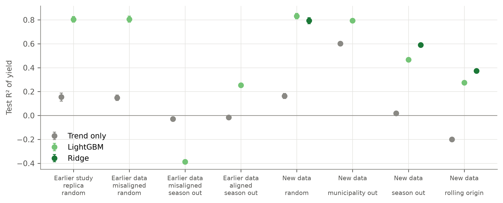
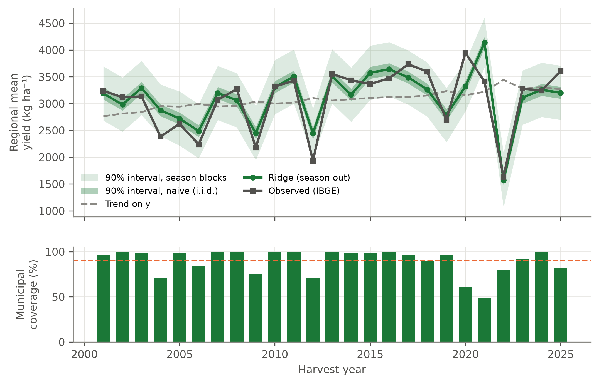
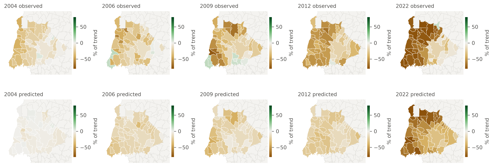
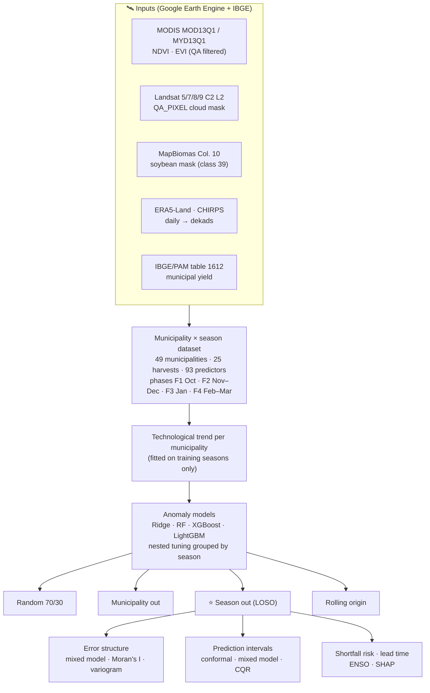
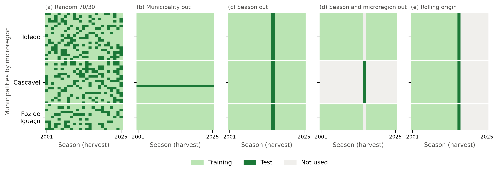
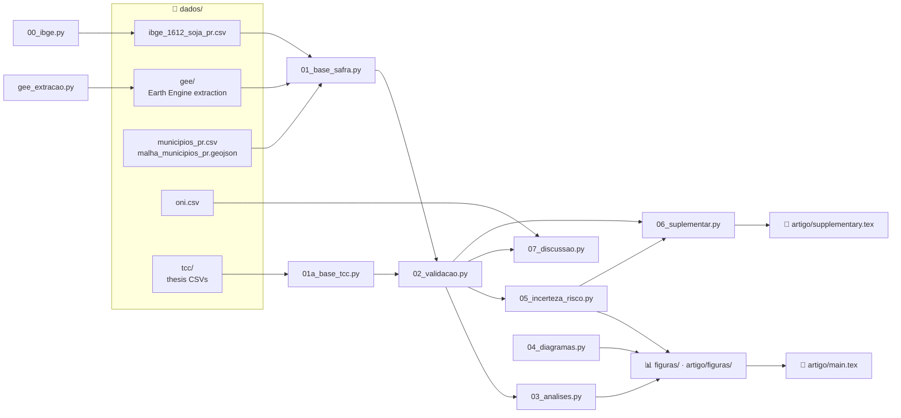

<<<<<<< HEAD
# 🌱 Soybean Yield Forecasting in Western Paraná, Brazil

### Season-blocked validation, spatio-temporal error structure and shortfall risk

<!-- provisional repository name: update "soybean_west_pr" in the visitor counter once the repository is created -->


Code, data and manuscript of an article in preparation for *Stochastic Environmental Research and Risk
Assessment* (Springer).

The study forecasts the **soybean yield of 49 municipalities of western Paraná, Brazil, for the harvests of
2001 to 2025**. It uses MODIS vegetation indices and ERA5-Land and CHIRPS weather, aggregated by phenological
phase, and asks how the **dependence between municipalities of the same season** affects:

1. the skill reported by different validation schemes;
2. the structure of the forecast errors;
3. the calibration of prediction intervals;
4. the forecast of **yield shortfall risk**.

The work extends the undergraduate thesis of Julia Tluszcz (UTFPR Medianeira, 2025). The thesis dataset is
kept in `dados/tcc/` for comparison.

**Authors**
- Julia Tluszcz, Universidade Tecnológica Federal do Paraná (UTFPR), Medianeira
- Pedro Luiz de Paula Filho, UTFPR, Medianeira
- Fabrício Correia de Oliveira, UTFPR, Santa Helena (corresponding author)

---

## 🔎 Key findings

| | Result |
|---|---|
| **Validation** | Random and leave-one-municipality-out splits give R² ≈ 0.80 **even when yields are paired with the weather of the wrong season**. Leave-one-season-out (LOSO) gives R² = 0.59 for ridge regression, a 58% reduction of the error of the technological trend. |
| **Models** | Strongly regularised ridge regression outperforms random forest, XGBoost and LightGBM (R² 0.45–0.47). The 1225 records are equivalent to about 34 independent observations. |
| **Error structure** | The season effect accounts for 73% of the variance of yield anomalies and 40% of the residuals. Residuals are spatially autocorrelated in 22 of 25 seasons (median Moran's I = 0.31). |
| **Uncertainty** | 90% intervals that assume independent municipal errors cover the regional mean yield in 32% of the seasons. Season-block conformal and mixed-model intervals cover 84%. |
| **Shortfall risk** | Yields below 80% of the trend are forecast with a Brier skill score of 0.51 and an AUC of 0.94. |
| **Lead time** | A forecast issued in early February retains 93% of the final skill. ENSO (ONI) adds no early signal. |
| **Scale** | R² = 0.59 for municipalities, 0.71 for microregions and 0.74 for the regional mean. Relative RMSE: 15.4%, 11.7% and 9.6%. |
| **Data** | The original thesis dataset paired each season with the previous harvest. The dataset was re-extracted in Earth Engine with quality and cloud masks. Landsat adds no information to MODIS at the municipal scale. |

<p align="center">
  <br>
  <em>Test R² by dataset and validation scheme: random splits report the same skill with correct and misaligned yields.</em>
</p>

<p align="center">
  <br>
  <em>Regional mean yield, LOSO forecast and 90% intervals: naive (i.i.d.) versus season blocks.</em>
</p>

<p align="center">
  <br>
  <em>Observed and forecast yield anomalies (% of trend) in the five seasons with widespread shortfall.</em>
</p>

---

## 🧭 Study design



### Validation schemes

<p align="center">
  <br>
  <em>Training and test sets of each scheme, as municipalities (rows) × seasons (columns). Only (c)–(e) withhold whole seasons.</em>
</p>

---

## 🗺️ How the files connect



## 📁 Repository structure

```
├── analise/                       # analysis scripts, run in numerical order
│   ├── 00_ibge.py                 #   IBGE/PAM table 1612 download and check of the thesis year labels
│   ├── gee_extracao.py            #   Earth Engine extraction by municipality and season (cached)
│   ├── 01_base_safra.py           #   main dataset (MODIS) and MODIS + Landsat variant
│   ├── 01a_base_tcc.py            #   thesis dataset, original (misaligned) and aligned
│   ├── 02_validacao.py            #   validation schemes, nested tuning, trend forms, season bootstrap
│   ├── 03_analises.py             #   maps, error structure, lead time, SHAP (--rapido: figures only)
│   ├── 04_diagramas.py            #   workflow and validation-scheme diagrams
│   ├── 05_incerteza_risco.py      #   variance components, variogram, intervals, shortfall risk
│   ├── 06_suplementar.py          #   supplementary tables and figure
│   ├── 07_discussao.py            #   ENSO, effective sample size, accuracy by scale
│   └── semeia_cache.py            #   resumes 02_validacao.py after an interruption
├── dados/                         # input data
│   ├── gee/                       #   Earth Engine extraction (climate, MODIS, Landsat; 2001–2025)
│   ├── tcc/                       #   thesis CSVs (comparison only)
│   ├── ibge_1612_soja_pr.csv      #   municipal soybean yield, Paraná
│   ├── municipios_pr.csv          #   municipalities: code, coordinates, altitude, microregion
│   ├── malha_municipios_pr.geojson
│   └── oni.csv                    #   Oceanic Niño Index (NOAA CPC)
├── resultados/                    # datasets, out-of-sample forecasts and result tables (CSV)
├── figuras/                       # figures (PNG, 300 dpi)
├── artigo/                        # manuscript (Springer Nature sn-jnl), supplementary material, bibliography
├── requirements.txt
└── README.md
```

Folder and script names are in Portuguese: `analise` = analysis, `dados` = data, `resultados` = results,
`figuras` = figures, `artigo` = manuscript, `safra` = season, `tcc` = undergraduate thesis.

## ▶️ Reproducing the study

```bash
# environment (Python 3.13)
python3.13 -m venv .venv && .venv/bin/pip install -r requirements.txt

# data
.venv/bin/python analise/00_ibge.py
.venv/bin/python analise/gee_extracao.py        # authenticated Earth Engine project required (~40 min)
.venv/bin/python analise/01a_base_tcc.py
.venv/bin/python analise/01_base_safra.py

# analyses
.venv/bin/python analise/02_validacao.py        # ~2 h (nested tuning); resumable
.venv/bin/python analise/03_analises.py
.venv/bin/python analise/04_diagramas.py
.venv/bin/python analise/05_incerteza_risco.py
.venv/bin/python analise/06_suplementar.py
.venv/bin/python analise/07_discussao.py

# manuscript
cd artigo && latexmk -pdf main.tex && latexmk -pdf supplementary.tex
```

The Earth Engine extraction is already cached in `dados/gee/`, so the analyses can be reproduced without an
Earth Engine account by starting at `01_base_safra.py`.

## 📚 Data sources

| Data | Source | Use |
|---|---|---|
| Soybean yield | IBGE, Municipal Agricultural Production, table 1612 | target (kg ha⁻¹), harvests 2001–2025 |
| NDVI, EVI | MODIS MOD13Q1 and MYD13Q1, collection 6.1 (250 m) | vegetation predictors |
| NDVI, EVI | Landsat 5/7/8/9 Collection 2 Level 2 (30 m) | sensor comparison |
| Soybean mask | MapBiomas Collection 10, class 39 | masking of vegetation indices, soybean area |
| Weather | ERA5-Land daily aggregates | temperature, radiation, evapotranspiration, soil water |
| Precipitation | CHIRPS daily | precipitation, dry days, water balance |
| ENSO | NOAA CPC Oceanic Niño Index | early-season signal test |
| Municipal limits | IBGE | maps |

## 📄 Citation

The article is in preparation. Until it is published, please cite this repository and the thesis:

> Tluszcz J (2025) Modelos de regressão aplicados a dados climatológicos de reanálise e índices vegetativos
> para predição de produtividade da soja. Undergraduate thesis, Universidade Tecnológica Federal do Paraná,
> Medianeira.
=======
# soybean_yield_forecasts
>>>>>>> 7a9d5435260944d4acc504751e905cfbe52f2448
